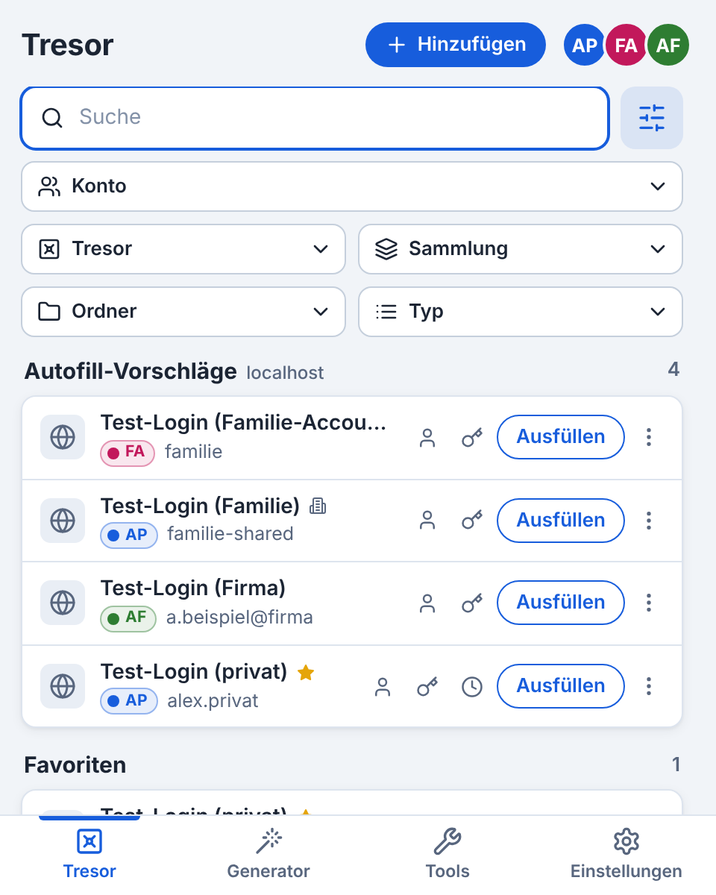

<p align="center">
  
</p>

<h1 align="center">MultiWarden</h1>

<p align="center">
  <b>One vault for all your Bitwarden accounts.</b><br>
  A browser extension for Chrome, Edge, Firefox and Opera that stays signed in to several Bitwarden and Vaultwarden servers at once.
</p>

<p align="center">
  
</p>

> [!NOTE]
> MultiWarden is an unofficial project and is not affiliated with Bitwarden Inc. It only talks to the public client API and uses Bitwarden's documented encryption format.

## What is it?

The official Bitwarden extension shows one account at a time. If you have a personal account, a work account and maybe your own Vaultwarden server, you keep switching back and forth.

MultiWarden signs in to any number of accounts on any servers at the same time (Bitwarden Cloud US/EU, self-hosted Bitwarden, Vaultwarden) and shows **one combined vault** with the items of all unlocked accounts. Autofill, the inline menu, passkeys and search work across all accounts as well. Every item carries a colored account badge, and the extra **"Account"** filter narrows the list down to a single account when you need it.

On top of that you get the features of the official Bitwarden extension (as of 2026.10), including **Send**, plus tools of its own such as a **duplicate check** and a **password report**.

## Features

<details open>
<summary><b>Accounts and login</b></summary>

- **Multiple accounts side by side**, including several accounts on the same server.
- **Master password** (PBKDF2 and Argon2id), new-device verification by email code on Bitwarden Cloud.
- **Log in with device** (approval on another device, with fingerprint phrase) and **sign in with passkey** (with PRF the vault is unlocked right away).
- **SSO** (also Vaultwarden with OpenID Connect) including **trusted devices (TDE)** and **Key Connector**.
- **Two-step login**: authenticator app, email, YubiKey OTP, Duo (Universal Prompt) and security key/FIDO2; "Remember on this device" for all methods.
- Create an account, request the master password hint, **custom server URLs** for individual services.

</details>

<details>
<summary><b>Unlock, lock and security</b></summary>

- **Shared unlock**: one password unlocks every account that uses this master password.
- **PIN** for all accounts (optionally only until the browser restarts, disabled after five failed attempts).
- **Biometrics** with Windows Hello, Touch ID or a security key via WebAuthn with the PRF extension (instead of the Bitwarden desktop app).
- **Vault timeout** from "immediately" to "never", action lock or log out, lock when the system locks.
- **Change master password**, approve login requests from other devices, manage devices, show the fingerprint phrase.

</details>

<details>
<summary><b>Vault and items</b></summary>

- Search across all accounts; filters for account, vault, collection, folder and type (including "Login with passkey"); favorites and autofill suggestions for the current page.
- **Item types**: login (TOTP with countdown and QR code scan from the page), card, identity, secure note, SSH key, as well as bank account, driver's license and passport.
- Create (with target account), edit, clone, delete, restore, archive, assign to an organization and collections; manage folders.
- **Attachments**: upload and download (encrypted and decrypted in the browser).
- **Quick copy** of username, password and TOTP right in the list; the same actions are always at the top of the ⋮ menu of every login.
- Check passwords against data breaches (Have I Been Pwned, k-anonymity).
- **Live sync**: changes from other devices arrive immediately (Vaultwarden too).

</details>

<details>
<summary><b>Autofill and passkeys</b></summary>

- Logins, cards and identities from all accounts via the popup, the **inline menu** in the field, the context menu or keyboard shortcuts (**Ctrl+Shift+L**, press again for the next match).
- **Restrict filling to a domain or subdomain**: per item ("Fill on": whole domain incl. subdomains, only exactly the saved subdomain, or individually per website) and as the default for all items. This is stored as a URI match detection in Bitwarden's format, so the official apps respect it too.
- Fill on page load, HTTP authentication dialogs (Basic/Digest), blocked domains, `data-bwignore` and `data-bwautofill`.
- **"Save login?"** and **"Update password?"** with a choice of account and folder, also for multi-step logins.
- Protection against filling the wrong place: foreign origins (e.g. embedded frames of other websites) are never filled, https logins on http pages and non-matching items only after confirmation; "Master password re-prompt" is respected.
- Optional **phishing warning** using Bitwarden's phishing list (checked locally on the device).
- Use **passkeys** from all unlocked accounts and save new ones to an account of your choice; same format as the official client. Inside an item you can show the details of each passkey (website, user, credential ID, creation date …) – the private key stays hidden.

</details>

<details>
<summary><b>Generator, import, export and organizations</b></summary>

- Password, passphrase (EFF word list) and username, including forwarded email aliases (addy.io, DuckDuckGo, Fastmail, Firefox Relay, Forward Email, SimpleLogin); encrypted generator history.
- **Export** as JSON, CSV, encrypted JSON and ZIP with attachments; **import** from Bitwarden (encrypted too), KeePass 2 and CSV exports of other password managers.
- Organization **policies** are enforced like in the official client; **event logs** and **at-risk passwords** (Access Intelligence) are supported.

</details>

<details>
<summary><b>Tools</b></summary>

A tab of its own in the bottom bar; every tool works within one selected account:
- **Duplicate check**: finds duplicate logins (same website and same username, optionally also the same password), cards, identities, notes and SSH keys. For each group you can keep the most recently changed item and move the rest to the trash. Duplicates across different accounts are deliberately not detected.
- **Send**: share text and files (up to 500 MB) end-to-end encrypted via a link – with deletion date, maximum access count, password, private notes, hidden email address and the option to disable it; edit, remove the password and delete. Compatible with Bitwarden and Vaultwarden (cross-checked with the official CLI); the "Remove Send" and "Send options" policies are respected.
- **Receive Send**: open Send links (including ones protected by a password or email verification) right in the extension – show and copy text, download files; decryption happens on the device. If the current tab is a Send link, it is picked up automatically.
- **Password report**: weak and reused passwords, logins on unencrypted http sites, passwords found in data breaches (Have I Been Pwned, on demand) and websites that support authenticator apps but have no TOTP key saved (list from 2fa.directory, on demand).

</details>

<details>
<summary><b>Appearance</b></summary>

- Languages: German, English, French and Spanish (system language by default).
- Themes MultiWarden, Mint, Tuvia, Red, Gray and custom colors (built-in color picker or hex code), each in light, dark or following the system.
- Compact mode, three popup widths, settings on one page or in sub-pages, sidebar in Firefox and Opera.

</details>

**Not supported:** pairing with the Bitwarden desktop app, Sends of vault items (a new Bitwarden feature), and passkeys in iframes or with algorithms other than ES256 (those requests are still handled by the browser).


## Privacy and security

- The master password never leaves the browser; only the derived login hash is sent to the server.
- Only encrypted vault data and tokens are stored locally (`chrome.storage.local`). Decrypted keys live only in volatile session storage – except with the vault timeout "Never", as in the official client.
- Websites and content scripts have no access to this storage. The inline menu runs in an isolated iframe and needs a one-time token bound to the tab, frame and URL.
- PIN and biometrics protect the user key with a key of their own (PIN: Argon2id, biometrics: the authenticator's PRF output).
- External requests only go to your accounts' servers, to Have I Been Pwned (only when checking, with k-anonymity), to Bitwarden's phishing list (only if enabled), to the alias services you use in the generator, to 2fa.directory (only when loading the list in the password report; nothing about your items is sent) and, when receiving a Send, to the server from the link.

## Development

Requirement: **Node.js 20** or later.

```bash
npm install
npm run build        # dist/chrome, dist/firefox, dist/opera
npm run build:test   # the same with test hooks (for the browser tests)
npm run typecheck
npm run format
npm run package      # release ZIPs (without test hooks) and source ZIP in release/
```

### Project layout

| Path | Contents |
| --- | --- |
| `src/background/` | Service worker: accounts, login, sync, live sync, autofill, passkeys, export/import, policies, Send |
| `src/crypto/` | Bitwarden cryptography (EncString, COSE, KDFs), TOTP, fingerprint phrase, WebAuthn |
| `src/content/` | Content scripts: form detection, filling, passkey bridge |
| `src/popup/` | Popup, sidebar and settings (Preact) |
| `src/inline-menu/`, `src/notification/`, `src/fido2/` | Inline menu, save bar, passkey dialog |
| `src/shared/` | Shared types, translations, themes, policies, list of open source components |
| `static/` | Manifest, HTML pages, icons, store texts (`_locales`) |
| `scripts/` | Packaging, license notices, translation tools, icon rendering |
| `tests/` | Node and browser tests, test websites, server mocks |

### Tests

The tests run against real Vaultwarden servers and a Playwright-controlled Chromium instance with the extension loaded.

Requirements:

- a recent **Vaultwarden** binary with SSO support (directory in `VW_DIR`),
- **Chromium**: either `npx playwright-core install chromium` or the path in `CHROMIUM_PATH`,
- optionally the **official Bitwarden CLI** (`npm i -g @bitwarden/cli`, otherwise the path in `BW_CLI`) for the compatibility test.

```bash
export VW_DIR=$HOME/vaultwarden                  # contains the "vaultwarden" binary
export MW_TEST_TMP=/tmp/multiwarden-tests        # working directory (default: $TMPDIR/multiwarden-tests)
mkdir -p $MW_TEST_TMP
openssl req -x509 -newkey rsa:2048 -nodes -subj /CN=localhost -days 365 \
  -keyout $MW_TEST_TMP/tls.key -out $MW_TEST_TMP/tls.crt

./tests/reset-servers.sh                         # Vaultwarden on 8001, 8002 (test data) and 8003 (SSO), IdP on 9100
node tests/serve.mjs &                           # test websites on 9000
node tests/tls-proxy.mjs 8443 8001 $MW_TEST_TMP/tls.key $MW_TEST_TMP/tls.crt &   # https for the CLI
./tests/run-all.sh                               # all tests (about 15–20 minutes)
```

Single tests: `./tests/run-node.sh tests/service.test.ts` (Node, `chrome.*` is mocked) or `node tests/e2e-ui.mjs` (browser, run `npm run build:test` first).

| Test | Covers |
| --- | --- |
| `crypto`, `policies` | Cryptography with test vectors from the Bitwarden SDK, TOTP, fingerprint, policies |
| `service`, `twofactor`, `features`, `sso` | Login, sync, editing, two-step login, attachments, PIN, passkeys and SSO against Vaultwarden |
| `tde`, `e2e-passkey` | TDE, Key Connector, Duo, passkey login and at-risk passwords against server mocks |
| `tools` | Send (crypto, create, edit, receive incl. files), Send links, duplicate check, password strength, domain/subdomain matching |
| `compat` | Passkeys, export/import, fingerprint and Send cross-checked with the official CLI |
| `e2e`, `e2e-autofill`, `e2e-fill` | Filters, search and filling (popup, inline menu, iframes, context menu, shortcuts, Basic auth) |
| `e2e-ui` | Languages, themes, layout, quick copy, menus, filters, color picker, sidebar, phishing warning, license info |
| `e2e-toolbox` | Tools tab (duplicates, password report, Send, receive), passkey filter and details, "Fill on" with real subdomains |
| `e2e-items`, `e2e-tools` | Attachments, archive, folders, item types, generator, export and import |
| `e2e-account`, `e2e-org`, `e2e-live`, `e2e-features` | Account, biometrics, policies, event logs, live sync, security keys, SSO |

## License

MultiWarden is free software under the **GNU General Public License v3.0 or later** ([`LICENSE`](LICENSE)).

### Open source components

Included in the extension:

| Component | License | Used for |
| --- | --- | --- |
| [Preact](https://github.com/preactjs/preact) | MIT | User interface |
| [noble-ciphers](https://github.com/paulmillr/noble-ciphers) | MIT | AES, XChaCha20-Poly1305 |
| [hash-wasm](https://github.com/Daninet/hash-wasm) | MIT | Argon2id (Argon2 part based on [Go x/crypto](https://github.com/golang/crypto), BSD-3-Clause; BLAKE2b reference code under CC0) |
| [tldts](https://github.com/remusao/tldts) | MIT | Domain detection |
| [Public Suffix List](https://github.com/publicsuffix/list) | MPL-2.0 | Domain suffixes (bundled in tldts) |
| [jsQR](https://github.com/cozmo/jsQR) | Apache-2.0 | QR code scan |
| [fflate](https://github.com/101arrowz/fflate) | MIT | ZIP export |
| [Lucide](https://github.com/lucide-icons/lucide) | ISC (some icons from Feather, MIT) | Icons |
| [EFF Long Wordlist](https://www.eff.org/dice) | CC BY 3.0 US | Passphrases, fingerprint phrase (unmodified) |

The list lives in [`src/shared/third-party.json`](src/shared/third-party.json) and is shown in the settings under "About". During the build, [`scripts/notices.mjs`](scripts/notices.mjs) generates `THIRD-PARTY-NOTICES.txt` from it with the full license texts (from `node_modules` or [`licenses/`](licenses)) and puts it into every package together with `LICENSE.txt`.

Other sources:

- **[Bitwarden Clients](https://github.com/bitwarden/clients)** (GPL-3.0) served as the reference for protocol, data formats and behavior. MultiWarden is written independently; only interface details such as field names and enum values were taken over.
- **[Bitwarden SDK](https://github.com/bitwarden/sdk-internal)** (`GPL-3.0-only OR Bitwarden SDK License`): the test vectors in `tests/crypto.test.ts` and `tests/tools.test.ts` come from it and are used under the GPL-3.0. They are not part of the extension.
- **[Vaultwarden](https://github.com/dani-garcia/vaultwarden)** (AGPL-3.0) and the **Bitwarden CLI** (GPL-3.0) are only used as external programs for the tests.
- Development tools (esbuild, TypeScript, Playwright, Prettier, qrcode) are not part of the extension.

Bitwarden is a trademark of Bitwarden Inc. MultiWarden is an independent project and is neither endorsed nor reviewed by Bitwarden Inc.
